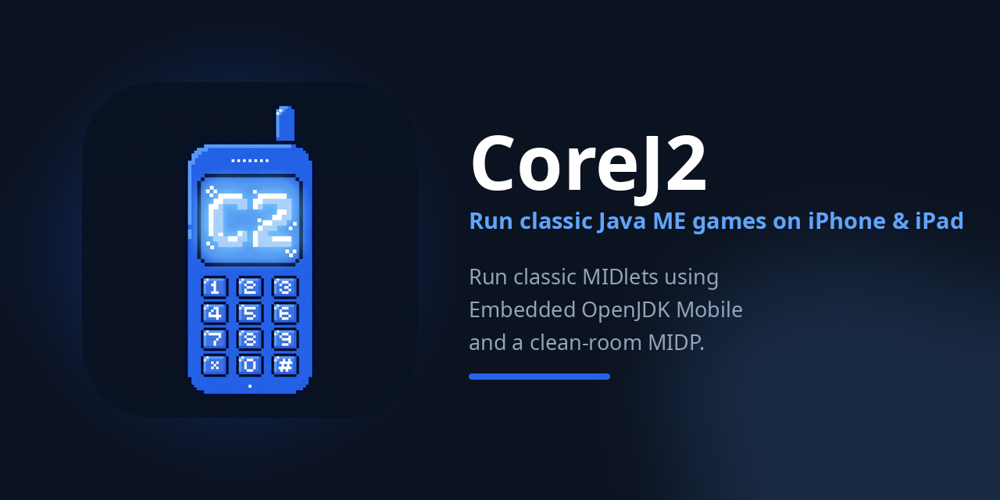
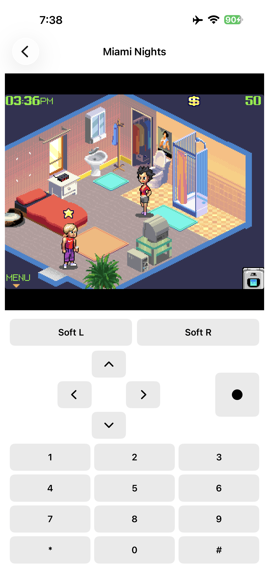
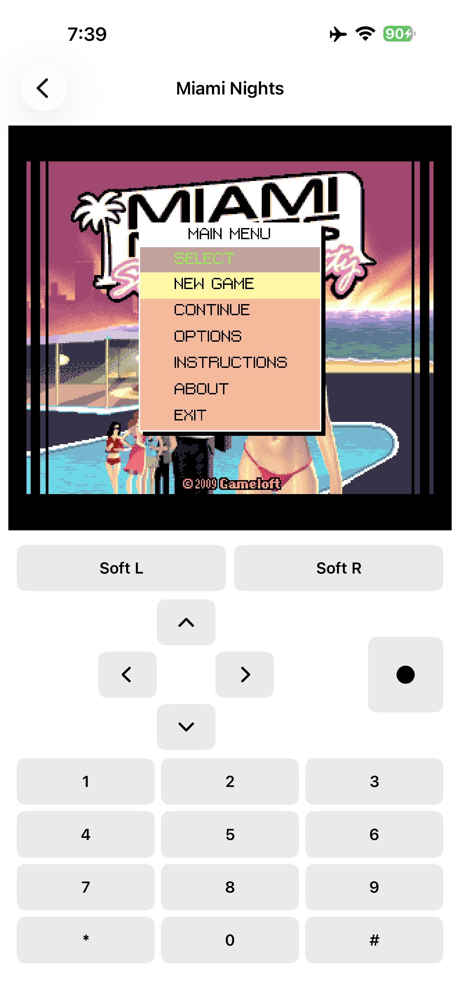

# CoreJ2

**Run classic Java ME (J2ME) games natively on iPhone & iPad.**

Embedded OpenJDK Mobile · Clean-room MIDP · SwiftUI · Free for personal use

<p align="center">
  
</p>

<p align="center">
  <a href="https://github.com/AbadXDev/CoreJ2/releases"></a>
  <a href="https://github.com/AbadXDev/CoreJ2/blob/main/LICENSE"></a>
  
</p>

<p align="center">
  
  
  
  
</p>

---

## Current Status

Validated on a physical **iPhone XS Max (iOS 18.7.1)**. iPhone + iPad, iOS 17+.

| Feature | Status |
|---------|--------|
| Embedded OpenJDK Mobile (Zero, statically linked) | ✅ |
| Clean-room MIDP 2.0 / CLDC runtime (own implementation) | ✅ |
| Pure-Java graphics (no AWT on iOS) | ✅ |
| Commercial MIDlets | ✅ |
| LCD rendering | ✅ |
| On-screen controls (D-pad, soft keys, keypad, touch pointer) | ✅ |
| Device profiles (96×65 – 480×800, auto-detected) | ✅ |
| Save / Load (RMS), per-game savedata management | ✅ |
| Native audio (MIDI / WAV via AVAudio bridge) | ✅ |
| Vibration (haptics) | ✅ |
| Settings (theme, keypad, vibration) | ✅ |
| Switch games without restarting the app | ✅ |
| M3G 3D (JSR-184, software renderer) | ✅ |
| Performance (frame pacing, skip unchanged frames) | ✅ |
| Compatibility expansion | 🚧 In Progress |

> **Known limitation:** HotSpot can only create one VM per process, so CoreJ2 keeps a single VM alive and swaps MIDlet sessions inside it.

---

## Compatibility (device-validated)

| Game | Result |
|------|--------|
| Miami Nights: Singles in the City (EN v1.0.8 / ES-ML v1.0.3) | ✅ Playable, audio |
| Gangstar 2: Kings of L.A. | ✅ Paints / playable |
| Bounce Tales | ✅ Paints / playable |
| Real Football 2011 | ✅ Paints / playable |
| Prince of Persia: Las Arenas Olvidadas (640×360 touch) | ✅ Paints / playable |
| Assassin's Creed (640×360 touch) | ✅ Paints / playable |
| Diamond Rush | ✅ Paints / playable |
| Asphalt 3: Street Rules 3D | ✅ M3G 3D painting |

CoreJ2 ships **no games**. You load your own `.jar` files.

---

## Reference Game

### Miami Nights: Singles in the City

| Check | Result |
|-------|--------|
| Launch | ✓ |
| Menus | ✓ |
| Gameplay | ✓ |
| Audio (MIDI/WAV) | ✓ |
| Save / Load (RMS) | ✓ |
| On-screen controls | ✓ |
| Stable gameplay | ✓ |

<p align="center">
  
  &nbsp;
  
</p>

<p align="center">
  <em>Gameplay and menu — Miami Nights on device</em>
</p>

---

## Architecture

```text
SwiftUI (Library · Emulator · Settings)
  ↓
Bridge (JNI gateway, key/audio/vibration events)
  ↓
Embedded OpenJDK Mobile (Zero interpreter, static libjvm)
  ↓
CoreJ2 clean-room MIDP (LCDUI · RMS · MMAPI · M3G · Nokia UI · GCF)
  ↓
Commercial MIDlet (.jar loaded by the user)
```

The static Zero image has no AWT on iOS, so CoreJ2 implements the MIDP
surface in pure Java (framebuffer images, PNG/BMP decoding, bitmap fonts,
software M3G). The shipped classpath is the **pure** one
(`scripts/embedded-jvm/compile-fase3-pure.sh`): 280 classes — ObjectWeb ASM
(BSD) plus CoreJ2's own clean-room MIDP written from the public
specifications (MIDP 2.0/JSR-118, CLDC 1.1, MMAPI/JSR-135, M3G/JSR-184).
`Vendor/FreeJ2ME` remains in the repo as a reference and as the build-time
source of ASM; **no FreeJ2ME classes ship in the app**.

---

## Building from Source

Requirements: macOS with Xcode, iPhoneOS SDK, autoconf, and a **Boot JDK 24**
(e.g. Azul Zulu 24).

```bash
# 1. Build the embedded JVM (OpenJDK Mobile, Zero) + pure MIDP classpath
scripts/openjdk-mobile/build-everything.sh

# 2. Open the Xcode project and run on a physical device
open CoreJ2.xcodeproj
```

Notes:

- The JVM build runs in a space-free path (`~/corej2-jvm`) because OpenJDK's
  configure rejects paths with spaces; artifacts are copied back into the repo.
- OpenJDK Mobile patches live in `patches/openjdk-mobile/` and are applied by
  `scripts/openjdk-mobile/apply-patches.sh` during the build.
- Simulator builds link without the JVM (device-only runtime).

---

## Roadmap

### Completed

- Embedded JVM (OpenJDK Mobile Zero, `JNI_CreateJavaVM` on device)
- Clean-room MIDP 2.0 / CLDC / MMAPI / M3G (pure classpath, no FreeJ2ME in the app)
- Pure-Java graphics (no AWT)
- Device profiles + auto-detection (Nokia, Sony Ericsson, Motorola, …)
- On-screen controls, settings, vibration
- Native audio (MIDI/WAV)
- RMS savedata management
- In-process game switching
- Frame pacing / performance pass

### Current Work

- Compatibility expansion
- Performance polish

### Future Work

- Controller support
- Per-game settings
- Save states

Full plan: [ROADMAP.md](ROADMAP.md)

---

## Brand

Official assets: [`assets/branding/`](assets/branding/) · [Guidelines](assets/branding/branding-guidelines.md)

Palette: `#2563EB` · `#60A5FA` · `#0B1220` · `#FFFFFF` · `#94A3B8`

---

## Status

🚧 **Alpha · v0.9.0-alpha** — commercial J2ME titles run on physical iPhone with
embedded OpenJDK Mobile and a clean-room MIDP. Broader compatibility is in
progress.

---

## Contributing

See [CONTRIBUTING.md](CONTRIBUTING.md), [CODE_OF_CONDUCT.md](CODE_OF_CONDUCT.md), and [SECURITY.md](SECURITY.md).

---

## License

**CoreJ2 is 100% free for personal, non-commercial use.** Commercial use is
not allowed without prior written permission from the author. If you publish
CoreJ2 anywhere or use any part of it in another project, **credit is
mandatory**: "CoreJ2 by Leonel Figuereo (AbadXDev)". See [LICENSE](LICENSE)
for the full terms.

Third-party components keep their own licenses:

- **OpenJDK Mobile**: GPLv2 with the Classpath Exception.
- **ObjectWeb ASM**: BSD license.
- **`Vendor/FreeJ2ME`** (reference only, not shipped in the app): **GPL-3.0**.
- Brand assets: original CoreJ2 identity (see branding guidelines).

---

<p align="center">
  <a href="https://github.com/AbadXDev/CoreJ2">GitHub</a> ·
  <a href="ROADMAP.md">Roadmap</a> ·
  <a href="CHANGELOG.md">Changelog</a>
</p>

<p align="center">Copyright © 2026 Leonel Figuereo (AbadXDev)</p>
