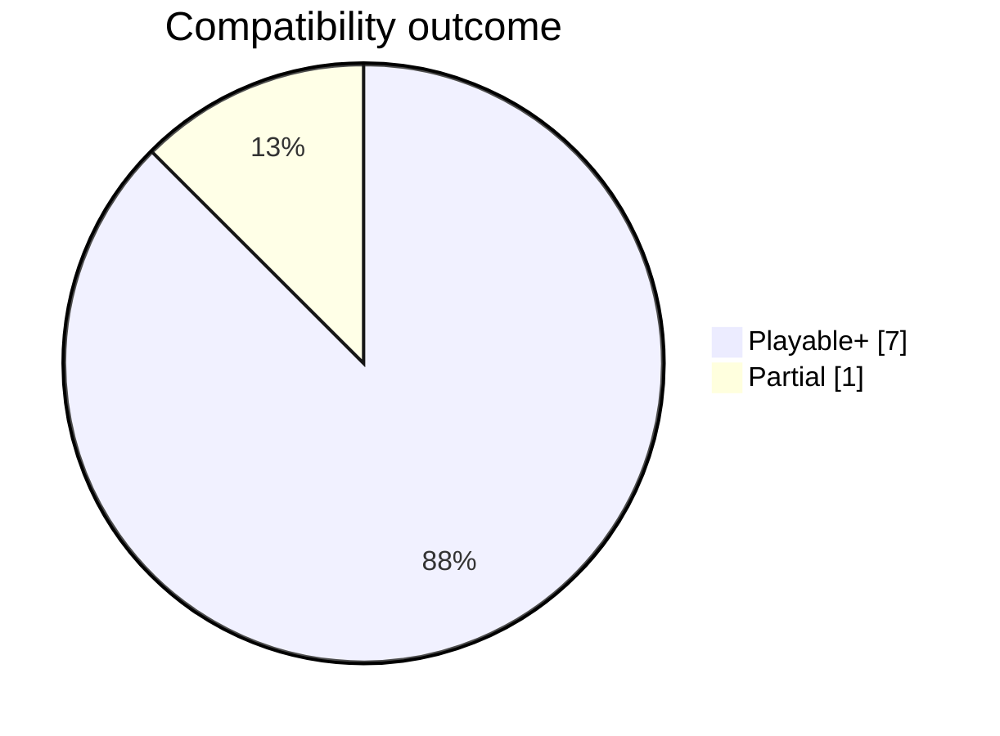
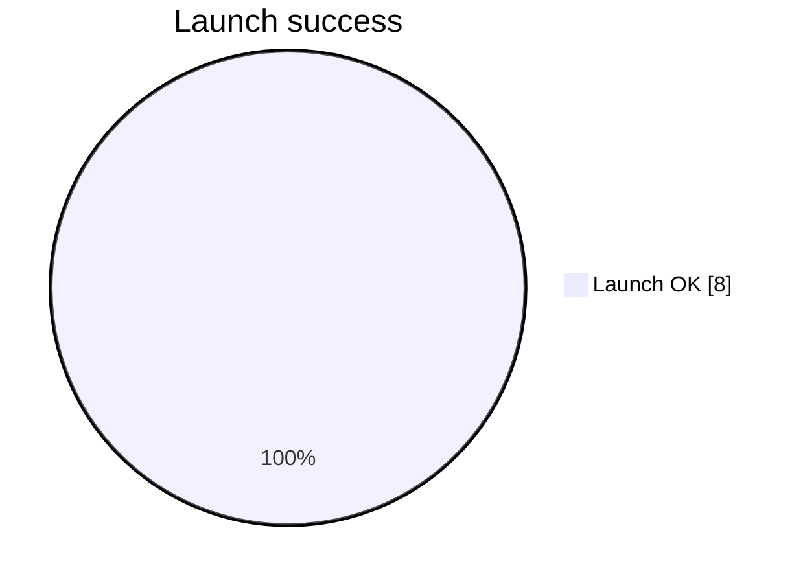
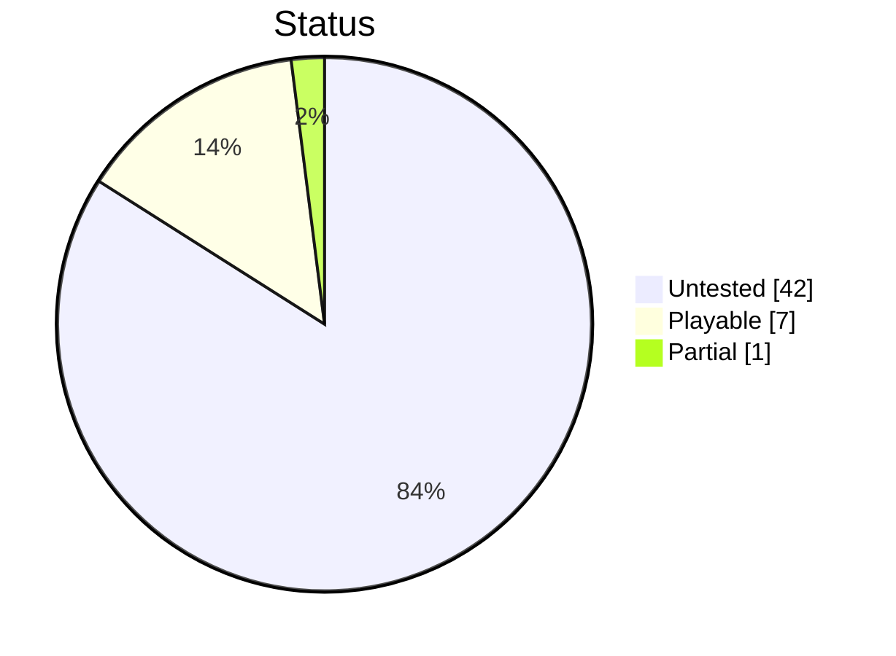
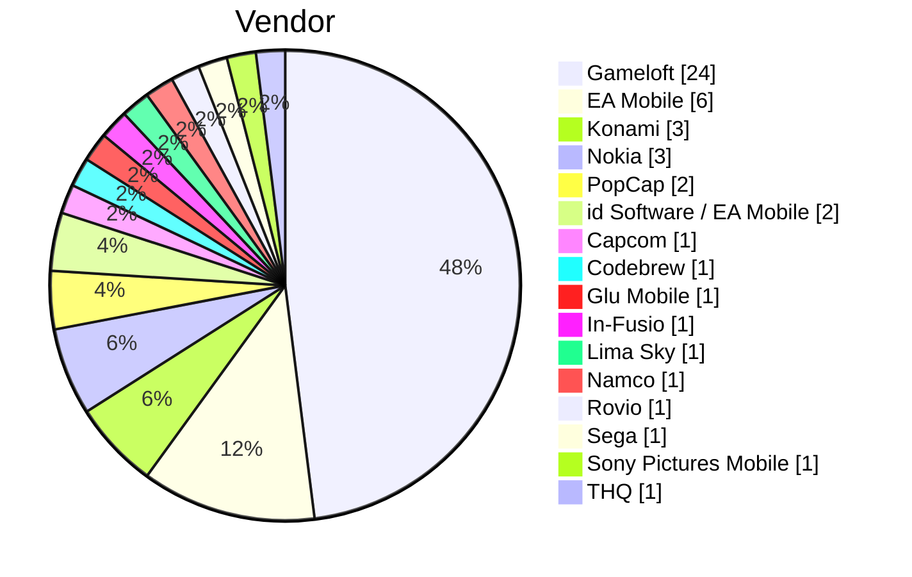
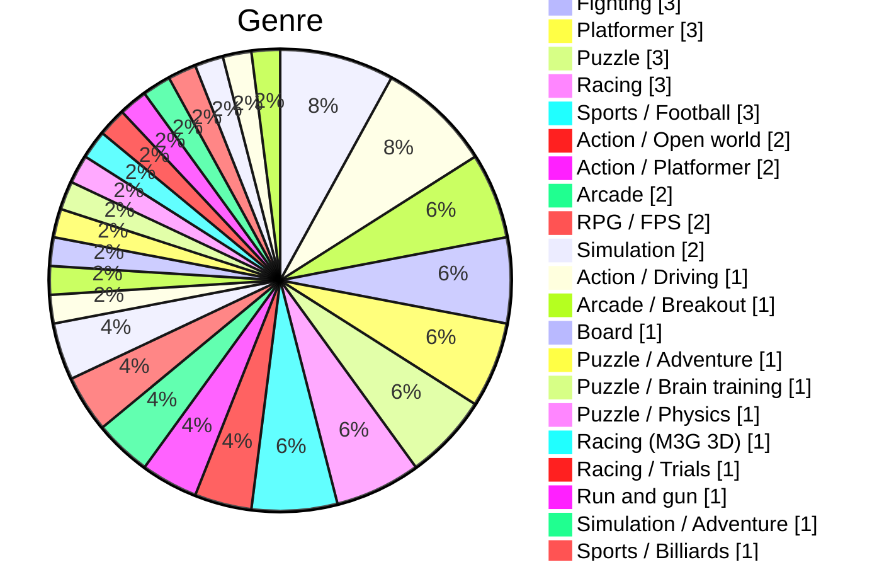
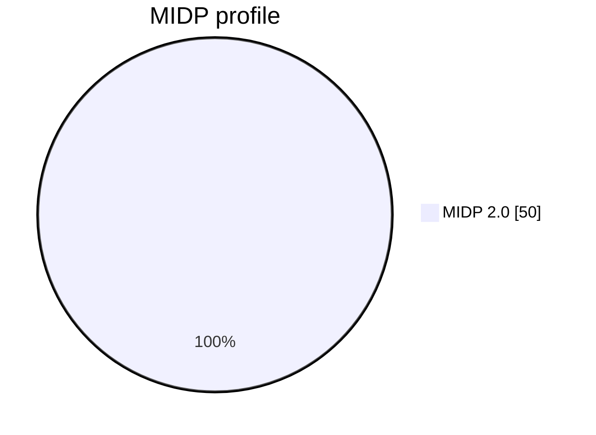

# Compatibility Statistics

Auto-generated from `compatibility/compatibility.json`. Re-run `scripts/docs/sync_compatibility.py` after editing the JSON.

## Headline rates

| Metric | Count | Rate |
|--------|------:|-----:|
| Titles tracked | 50 | 100% |
| Tested | 8 | 16.0% |
| Launch success (tested) | 8 | 100.0% |
| Playable+ (tested) | 7 | 87.5% |
| Partial (tested) | 1 | 12.5% |
| Launch only (tested) | 0 | 0.0% |
| Not working (tested) | 0 | 0.0% |

## Launch success

## Status distribution

## Vendor comparison

## Genre comparison

## MIDP comparison

## Notes

Charts reflect the **Top 50 target list**. Rates update automatically as titles are tested and `compatibility.json` is updated.
